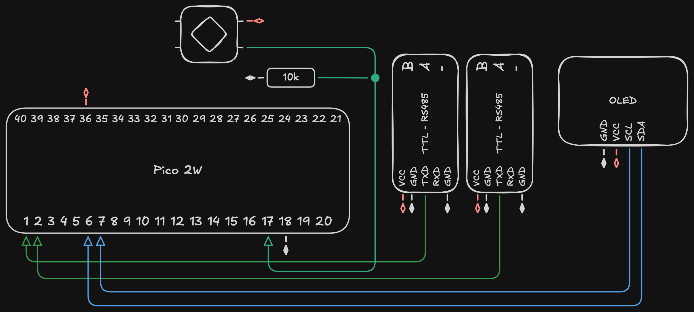
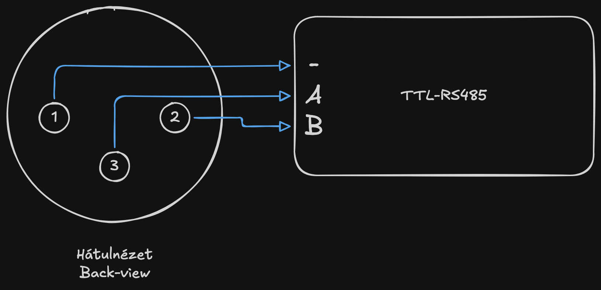

# Raspberry Pi Pico DMX/Art-Net Node

Fork of [`tmingos/Pico-ArtNet-DMX-Node`](https://github.com/tmingos/Pico-ArtNet-DMX-Node).
OC: Taylor Mingos,
His [blog post](https://www.techandtransit.com/lighting/pi-pico-artnet-to-dmx-node/).

---

Ez az ezköz WiFi-n érkező Art-Net jeleket alakít át DMX csomagokká, lehetővé téve reflektorok számítógépről/tabletről történő autómatikus vezérlését, irányítását 1024 csatornáig.

## Tartalom

- [Alkatrészlista](#alkatrészlista)
- [Működése](#működés)
  - [Hardver](#hardveres-leírás)
  - [Használata](#szoftver-használata)
- [Kapcsolási rajz](#kapcsolási-rajz)
- [Kód](#szoftver)
  - [Arduino IDE beállítása](#beállitások-az-arduino-ide-hez)

## Alkatrészlista

- 1db - **Raspberry Pi Pico 2W**
  > Figyelj, a W típusra, mert csak ennek van Wifi-je!
  >
  > A Pico (1)W-vel is működik elvileg (az eredeti kód azt is használta), de az én dizájnom (és könyvtár verzióim) a 2-est feltételezik
- 2db - **TTL-RS485 modul**
  > Ezek jelátalakítók a DMX differenciális jele és a Pico között
- 2db - **XLR ajzat**
  > Minden xlr csatlakozónak külön jelátalakítóra van szüksége
- 1db - **0.96" OLED kijelző**
- 1db - nyomógomb + 10k ellenállás
- 1db - bármilyen doboz
  > Én egy átlátszó fedelű műszerdobozt használtam, de ilyeneket nehezebb találni
- nyák lap, vezeték stb.

Ezek mind viszonylag elérhető és olcsó alapanyagok, nem nehéz őket beszerezni.

Pl: hestore.hu _(nem szponzorált)_

## Működés

### Hardveres leírás

Az egész magja egy Raspberry Pi Pico 2W. Ez azért jó választás mert kellően erős, (PIO-k nak köszönhetően a processzornak még dolga sincs a dmx kommunikációval, csak a wifivel), van beépített Wifi-je, pici és olcsó is.

Én 2 xlr ajzatot raktam rá (de egy is bőven elég), ezekhez 2 jelátalakítóra van szüksége a pico-nak. 2 xlr ajzat 2 dmx univerzumot jelent, ami 1024 csatorna!

A jelátalakítók fogadásra is képesek, de az én esetemben ez felesleges.
A jövőben lehet hogy fejlesztem hogy fogadni is tudjon pl egy kisebb konzoltól, azt rögzítse/visszajáttsza, vagy az art-net és a konzol jelét eggyesítse...

A kütyühöz egy kis kijelző is tartozik amely főleg Wifi információkat jelenít meg: Hálózat nevét, jelszavát (ha sajátját hoztaa létre), és IP címét.
A kijelzőn ikonok is megjelennek az adott üzemmódtól föggően. Valamint az univerzum konfigurációt is kiírja (melyik univerzum melyik ajzat).

Nem utolsó sorban egy gomb, mely jelenleg az egyéni konfigurációs módhoz van felhasználva. Hogy a gomb jele he lebegjen szabadon egy 10k-s lehúzó ellenállást kellett hozzáadni.

### Szoftver használata

> A Szoftver technikai működéséhez lásd a [Kód](./PicoArtNetNode/)ot

Az ezköz használata felettébb felhasználóbarát: csak dugd be és kész!

Bekapcsolás után egyből un. _Elérési pont_ módba vált, ezt egy adótorony ikon jelzi a kijelzőn. 
Ekkor a pico saját wifi hálózatot hoz létre (a kódban meghatározott névvel és jelszóval), ezek az adatok a kijelzőn is megjelennek (semmit se kell megjegyezni!).  
Ez után csak fel kell catlakozni erre a hálózatra a show megkezdéséhez.

 

Ha bekapcsolás közben nyomva tartjuk a gombot, akkor u. _Egyéni beállítás_ módba vált. Ezt fogaskerék ikon jelzi.

> lenyomjuk a gombot mielőtt bedugnánk, és addig nem engedjük el míg a kijelzőn adatok nem jelennek meg

A pico ekkor is először létrehozza saját hálózatát, majd a hálózatra csatlakozás után nyissuk meg a kijelzőn látható oldalt, hogy eljussunk a beállítási menübe.  
Jelenleg ez csak arra ad lehetőséget hogy a pico-t egy általunk választottmár meglévő hálózatra csatlakoztassuk.

> ! A pico-nak csak 2.4GHz-es antennája van. Ne felejtsük el bekapcsolni ezt a sávot routerünkön!

Az adatok mentésekor a pico elkezdi keresni az adott hálózatot és csatlakozik rá.
A sikeres csatlakozást wifi ikon jelzi. Ha a kapcsolódás sikertelen az "_Error_" felirat jelenik meg.

## Kapcsolási rajz

A Pico lábkiosztása elérhető: [itt](https://pip-assets.raspberrypi.com/categories/1088-raspberry-pi-pico-2-w/documents/RP-008305-DS-1-pico-2-w-pinout.pdf)

>  Az ábrák csak áttekintésre szolgálnak. Pontos adatokért látsd: a [kódot](./PicoArtNetNode/), az alábbi táblázatokat

| TTL RS485 modul 1. | Pico 2W       |
| -----------------: | :------------ |
|                GND | GND           |
|                VCC | 3v3 out       |
|                TXD | **_1 (GP0)_** |
|                RXD |               |
|                GND | GND           |

| TTL RS485 modul 2. | Pico 2W       |
| -----------------: | :------------ |
|                GND | GND           |
|                VCC | 3v3 out       |
|                TXD | **_2 (GP1)_** |
|                RXD |               |
|                GND | GND           |

| OLED |  Pico 2W      |
| ---: | :------------ |
|  GND | GND           |
|  VCC | 3v3           |
|  SCL | **_7 (GP5)_** |
|  SDA | **_6 (GP4)_** |

> Az SDA és SCL pinjei nem változtathatók meg, mert ezeken a pineken van az I2C busz

| Gomb | Pico 2W                                           |
| ---: | :------------------------------------------------ |
|    A | 3v3                                               |
|    B | **_17 (GP13)_**, lehúzóellenálláson keresztül GND |

## Szoftver

C++ ban készült (én nem nagyon értek hozzá, biztonyosan nagyon béna..).
Az eredeti program Arduino-s könyvtárakat használt, igy csak az Arduino IDE-ben lehet szerkeszteni :(

### Beállitások az Arduino IDE-hez

#### Pico 2W alaplap

Az arduino ide alapból nem tudja a pico 2W-t programozni, ezért extra alaplapként kell hozzáadni:

`Arduino` -> `Preferencies` -> `Additional Boards Manager URLs`:

`https://github.com/earlephilhower/arduino-pico/releases/download/global/package_rp2040_index.json`

#### Könyvtárak

- [`ArtnetWifi`](https://github.com/rstephan/ArtnetWifi/tree/master) (1.6.2)
- [`Pico-DMX`](https://github.com/jostlowe/Pico-DMX) (3.1.0)
- A kijelzőhöz:
  - `Adafruit SSD1306` 2.5.17
  - `Adafruit GFX Library` 1.12.6
  - `Adafruit BusIO` 1.7.14

### Kód

- [`PicoArtNetNode.ino`](./PicoArtNetNode/PicoArtNetNode.ino)
  > A program "magja"
- [`OLED.h`](./PicoArtNetNode/OLED.h)
- [`PicoWebServer.h`](./PicoArtNetNode/PicoWebServer.h)
  > Webszerver a webes beállítási módhoz

---

© 2026 Tatár Márton - Toldy Teátrum Technikus
